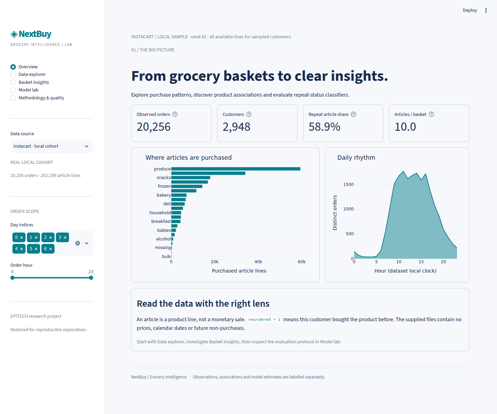

# NextBuy — Grocery Intelligence

An EPITECH data mining project restored as a reproducible Streamlit analytics application. NextBuy explores grocery ordering behaviour, measures product co-purchases and compares classifiers of repeat purchase **status** among articles already purchased.

`reordered = 1` means the customer has bought that product before. This project does not forecast a next basket or estimate the probability that an unpurchased product will be bought.



## What you can explore

- **Overview:** scoped order and customer counts, repeat article share, basket sizes, department volumes and hourly order activity.
- **Data explorer:** day/hour filters that preserve observed baskets, department selection, distributions, literal product search and CSV export.
- **Basket insights:** repeat share versus volume, first-in-cart ratios, exact product pair counts, support, directional confidence and lift; adjustable count thresholds and rankings.
- **Model lab:** on-demand evaluation of a prevalence baseline, logistic regression and random forest; ROC/precision–recall curves, Brier scores, classification reports, confusion matrices and inspection of actual held-out articles.
- **Methodology & quality:** table sizes, missingness, relational checks, provenance and scientific limitations.

## Run locally

Tested on Linux with **Python 3.12.3**. Python 3.12 is the supported deployment target.

```bash
python3.12 -m venv .venv
source .venv/bin/activate
python -m pip install -r requirements.lock.txt
streamlit run app.py
```

The repository includes a small, fully synthetic dataset, so a fresh installation works without external credentials or downloads at runtime. `requirements.txt` pins the five direct application dependencies; `requirements.lock.txt` captures the complete dependency set from the successfully installed clean Python 3.12 environment.

From the existing project environment, the single launch command is:

```bash
.venv/bin/python -m streamlit run app.py
```

The historical command `streamlit run nextbuy/app.py` also opens the restored application. Paths resolve from module locations rather than the shell's current directory.

## Data and provenance

The academic notebook identifies the **Instacart Online Grocery Shopping Dataset 2017**. The local source is a partial, modified extract, not the entire competition dataset. See the [official competition data page](https://www.kaggle.com/competitions/instacart-market-basket-analysis/data) and the original [Instacart release page](https://www.instacart.com/datasets/grocery-shopping-2017) for provenance. The precise upstream extraction recipe and redistribution terms were not supplied with these files; no licence permission is inferred here.

| Local source table | Rows | Purpose |
| --- | ---: | --- |
| orders | 1,444,444 | Anonymous customer and order context |
| order_products | 13,692,886 | Purchased article lines and repeat flags |
| products | 49,688 | Product labels and taxonomy keys |
| aisles | 134 | Aisle names |
| departments | 21 | Department names |

The complete source audit is in [source_audit.json](docs/source_audit.json). In particular, the files contain missing customer/context fields, 449 missing product IDs, 446 missing cart positions and 449 missing target flags. There are 86,903 orders without line coverage. Missing elapsed intervals on first orders are structural; additional missing intervals are treated as invalid.

### Analyse the supplied real data locally

Original CSVs remain in `nextbuy/datasets/` and are intentionally excluded from Git. Prepare a bounded seeded cohort without joining all 13.7 million lines in memory:

```bash
python scripts/prepare_data.py --local --users 3000
```

The script samples customer IDs with seed 42 and streams all available lines of their observed orders. It excludes invalid context records and **entire** baskets with corrupt lines or non-contiguous cart positions. Exact duplicate records are removed; conflicting keys fail loading. No target is imputed. Orders without lines are excluded. The local manifest records source SHA-256 hashes, sampling and exclusions. The supplied extraction produces 2,948 observed customers, 20,256 orders and 202,199 article lines after cleaning.

`data/local/` is ignored by Git. If present, the app defaults to this real cohort and also offers the synthetic demo in the source selector. Increasing `--users` increases resource use; use the default for demonstrations.

### Public demo data

`data/demo/` contains **650 generated customers, 6,244 orders and 44,312 article lines** (about 0.6 MB of CSVs). Generate it again with `python scripts/prepare_data.py`. Product labels are generic; no customer records or Instacart rows are copied. Its results demonstrate application behaviour and must never be reported as real market evidence. Read [DATA.md](docs/DATA.md) before redistributing real data or academic artefacts.

## Methodology and verified results

Order activity counts **distinct orders**, not article lines. Product volumes count purchased lines, not quantities or revenue. All basket sizes are retained. Product analysis uses observation thresholds; pair analysis enumerates combinations among the most frequent candidate products. Support uses **all selected observed orders**, including those without candidate products. Lift measures association, not promotional uplift.

The fixed ML protocol requires at least three observed orders per customer:

1. Older orders form a separate **history** partition.
2. The penultimate observed order supplies **training** labels.
3. The last observed order supplies the **test** labels.

Smoothed customer/product repeat rates and counts use the history partition only and stay frozen for training and testing. Numeric predictors are standardised, categorical predictors are one-hot encoded with unknown-category handling, and both fitted models have independent preprocessing. Settings are fixed; no model or hyperparameters are selected using the test set. The forest uses 80 trees, depth 10 and leaf size 8. Seed: 42. No heavy model is trained on page load; fitted experiments are cached with bounded entries and keyed to the data source and file signatures.

Executed on the **real local cohort**:

| Model | ROC-AUC ↑ | Average precision ↑ | Brier score ↓ |
| --- | ---: | ---: | ---: |
| Constant prevalence baseline | 0.500000 | 0.639054 | 0.231467 |
| Logistic regression | 0.737694 | 0.825968 | 0.196577 |
| Random forest | 0.748398 | 0.836000 | 0.194595 |

History: **145,303** article lines; training: **21,010**; test: **21,729**. **890** observed customers have fewer than three baskets and are excluded from ML. Test positive prevalence is **0.639054**. The entire cleaned cohort has a repeat article share of **58.87%** and **9.98** articles per observed basket. These populations differ by design.

See [evaluation.json](docs/evaluation.json) for executed real and synthetic results, complete classification reports and analytical outputs. Reproduce with:

```bash
python scripts/evaluate.py
```

On the verification host, both data sources were evaluated in one process with peak RSS around 272 MiB; individual runs took roughly two seconds or less. These are local measurements, not Community Cloud guarantees. No binary model artefacts are needed.

## Scientific limits

- The source extract is incomplete, and cleaning changes the population. Keeping all available lines does not prove upstream basket completeness.
- `reordered` describes purchase history among selected purchases. There are no examples of products that were not bought; this is not a purchase propensity model or a recommendation engine.
- Cart position is observed after product selection. Probabilities are retrospective model estimates, not validated future forecasts.
- The split is ordered within customers, with frozen history statistics. Without calendar dates, it is not a global chronological backtest; cross-customer calendar ordering cannot be established.
- Last observed orders may not be actual final orders. The protocol does not test generalisation to entirely new customers.
- No confidence intervals, probability calibration study, external validation or causal promotion effects are claimed.
- Day codes remain 0–6 without assumed weekday names. Days since prior order are capped at 30. No dates, prices, currencies or quantities are invented.
- Historical notebook outputs and narrative claims are retained as original academic evidence; they do not replace the corrected evaluation.

## Architecture

```text
app.py                         Streamlit entry point
nextbuy_core/
  data.py                      Schema, ranges, relational checks, merging, order filters
  analytics.py                 KPIs, product summaries and exact pair mining
  modeling.py                  History/train/test partitions, pipelines and evaluation
  charts.py                    Shared Plotly styling
  ui.py                        Five-page interface and bounded caches
scripts/
  prepare_data.py               Synthetic generation / streamed local cohort extraction
  audit_data.py                 Full source CSV audit
  evaluate.py                   Reproducible metrics outside Streamlit
  browser_check.py              Running-app Chromium checks and screenshots
notebooks/analysis.ipynb        Restored, executed analytical notebook
nextbuy/                       Original academic documents, notebook and source data
  app.py                       Compatibility launcher
  src/modeling.py               Historical ML implementation; not used by restored app
docs/                          Audit, metrics, deployment guide, report, portfolio, screenshots
  archive/                     Exact original dashboard and modeling script snapshots
tests/                         Data, analytics, leakage and Streamlit interaction checks
data/demo/                     Generated public demonstration tables
data/local/                    Ignored local real-data cohort
```

## Validation

```bash
python -m pip install -r requirements-dev.txt
python -m pytest -q
ruff check app.py nextbuy_core scripts tests
python -m pip check
python scripts/evaluate.py
# In another terminal while Streamlit is running:
python scripts/browser_check.py
```

The browser script uses a locally installed Playwright Chromium or `PLAYWRIGHT_CHROMIUM_EXECUTABLE`. If needed: `python -m playwright install chromium`. It visits all five pages, trains the real-cohort models, inspects a held-out article, downloads a searched CSV, records JavaScript errors and captures desktop/tablet/mobile views. AppTest also exercises the synthetic cloud path, filter empty states, rankings and model selection. See [VALIDATION.md](docs/VALIDATION.md) for actual results and scope.

The new notebook shares the application modules:

```bash
jupyter nbconvert --to notebook --execute notebooks/analysis.ipynb --inplace
```

## Deployment: Streamlit Community Cloud

The app is prepared for the free Community Cloud service; it has **not been published**. Use repository `aitbenamaraabdelkader27/Nextbuy-project`, branch containing the reviewed files, entry point **`app.py`**, and choose **Python 3.12** in Advanced settings. `.python-version` documents the local target; the cloud Python version must be selected in its UI. Configuration is in `.streamlit/config.toml`; no secrets or external service are required. The fresh-clone demo uses only synthetic records.

Read [DEPLOYMENT.md](docs/DEPLOYMENT.md) for steps and the data publication boundary. Community Cloud uses a dependency file to build its environment; see the [official dependency guide](https://docs.streamlit.io/deploy/concepts/dependencies) and [deployment guide](https://docs.streamlit.io/deploy/streamlit-community-cloud/deploy-your-app/deploy). Actual hosted resource use and cold starts remain unverified until an authorised deployment.

## Academic provenance and portfolio

The EPITECH project was a team effort. Original contributor descriptions, notebooks and scientific code are preserved; this restoration does not claim sole authorship of the academic work. No EPITECH repository or Git history was modified or imported. The personal `origin` points to `git@github.com:aitbenamaraabdelkader27/Nextbuy-project.git`.

Portfolio wording: [PORTFOLIO.md](docs/PORTFOLIO.md). Detailed restoration report: [RESTORATION_REPORT.md](docs/RESTORATION_REPORT.md). No project-wide licence is invented for the original team material or third-party data.
